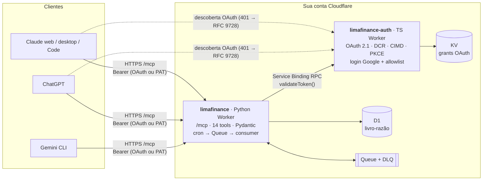

# limafinance

[](https://github.com/eduardopelima/limafinance/actions/workflows/pipeline.yml)


**Controle financeiro pessoal por conversa.** Um servidor [MCP](https://modelcontextprotocol.io) remoto que substitui a
planilha de gastos: você fala com o Claude, o ChatGPT ou o Gemini CLI, e eles registram e consultam seus lançamentos.
Sem app e sem site. Cada pessoa publica a própria instância na própria conta Cloudflare (plano Free).

> **Você:** gastei 45,90 no mercado ontem e 120 de gasolina hoje
> **Claude:** *(add_transactions)* Registrei 2 saídas: Alimentação › Mercado R$ 45,90 (23/11) e Transporte › Combustível R$ 120,00 (24/11).
> **Você:** quanto ainda posso gastar esse mês?
> **Claude:** *(month_summary)* Você gastou R$ 3.212,40 de um teto de R$ 6.000,00. Restam R$ 2.787,60, cerca de R$ 398/dia até o fim do mês.

## O que ele faz

- **Lançamentos em linguagem natural**, inclusive em lote ("registra esses 12 da fatura"), atômicos e idempotentes.
- **Consultas**: lista filtrada, resumo do mês por categoria vs. meta, saldo e teto restante (com R$/dia).
- **Competência ≠ data real** (a fatura de dezembro paga em janeiro), recorrências mensais como regra.
- **Escrita segura**: categoria inexistente é erro (nunca criada às escondidas), soft delete, auditoria de toda escrita.
- **Dinheiro em centavos inteiros**; "hoje" resolvido em `America/Sao_Paulo` (o Worker roda em UTC).
- **Importação** do histórico da planilha (CSV pt-BR) por script, com dry-run e reexecução segura.

## Arquitetura



- **Python para todo o domínio** (tools, regras, SQL, jobs, import, testes) no
  [Cloudflare Python Workers](https://developers.cloudflare.com/workers/languages/python/) com o SDK oficial `mcp` 2.x.
- **OAuth num Worker TypeScript isolado**, porque a [`workers-oauth-provider`](https://github.com/cloudflare/workers-oauth-provider)
  não tem equivalente em Python e OAuth não se reescreve à mão para dados financeiros. Ele não toca nos dados.
- **Stateless**: uma instância do servidor MCP por requisição; GET/DELETE `/mcp` → 405.
- **Multi-tenant desde o dia 1**: `user_id` em todas as tabelas, sempre vindo do token.

Decisões e trade-offs: [`docs/ARCHITECTURE.md`](docs/ARCHITECTURE.md) · Convenções para agentes: [`CLAUDE.md`](CLAUDE.md) · [`SECURITY.md`](SECURITY.md)

## Deploy your own

Requisitos: conta Cloudflare (plano Free serve), Node 22+, [uv](https://docs.astral.sh/uv/) 0.13.4+, uma conta Google.

```sh
git clone https://github.com/eduardopelima/limafinance && cd limafinance
cp limafinance.env.example limafinance.env          # LF_PREFIX e CF_WORKERS_SUBDOMAIN
uv run --no-project ci/deploy_your_own.py          # repita até terminar
```

O instalador verifica cada passo antes de agir e pula o que já está pronto: cria D1, KV e filas, grava os IDs no
`limafinance.env`, gera a config, roda as migrations, publica os dois Workers e verifica o deploy. Quando precisa de
algo que só você pode fazer, para com uma linha `NEEDS:` (exit 2) e o comando exato:

1. `npx wrangler login`
2. criar o OAuth client do Google ("Aplicativo da Web"; ele imprime o redirect URI) e colar o Client ID no `limafinance.env`
3. `npx wrangler secret put GOOGLE_CLIENT_SECRET` e `ALLOWED_EMAILS` (você digita no prompt oculto)

No fim ele imprime a URL `https://<prefixo>.<subdominio>.workers.dev/mcp`.

### Configuração

Tudo que é específico do seu deploy fica em **`limafinance.env`** (fora do git). Os `wrangler.jsonc` são **gerados**
(`ci/render_config.py`) a partir de `*/wrangler.base.jsonc` + esse arquivo. Segredos ficam só na Cloudflare.

| Chave | O quê |
|---|---|
| `LF_PREFIX` | prefixo de todos os nomes (Workers, D1, KV, filas) |
| `CF_WORKERS_SUBDOMAIN` | seu `<sub>.workers.dev` |
| `CF_ACCOUNT_ID` | opcional se você tem uma conta só |
| `GOOGLE_CLIENT_ID` | OAuth client do Google |
| `D1_ID_*`, `KV_ID_*` | preenchidos pelo instalador |

## Como usar

| Cliente | Conexão |
|---|---|
| **Claude** (web/desktop/celular) | Configurações → Conectores → Adicionar conector personalizado → URL `/mcp` → login Google |
| **ChatGPT** | Configurações → Apps/Conectores → modo desenvolvedor → URL `/mcp` (OAuth) |
| **Claude Code** | `claude mcp add --transport http limafinance <URL>/mcp` (OAuth via `/mcp`) ou com `--header "Authorization: Bearer lf_pat_..."` |
| **Gemini CLI** | `~/.gemini/settings.json`: `{"mcpServers":{"limafinance":{"httpUrl":"<URL>/mcp","headers":{"Authorization":"Bearer lf_pat_..."}}}}` |

PAT para clientes com header fixo: `cd mcp && uv run scripts/create_token.py --email voce@gmail.com --name claude-code --env production [--read-only]`.

**Importar a planilha** (CSV em `mcp/data/`, fora do git):
`cd mcp && uv run scripts/import_planilha.py --file data/planilha.csv --email voce@gmail.com --income-categories "Salário"`
(dry-run com relatório; adicione `--apply --env production` para gravar). Formato: [`mcp/scripts/exemplo-planilha.csv`](mcp/scripts/exemplo-planilha.csv).

<details>
<summary><b>As 14 tools</b></summary>

| Tool | Tipo | |
|---|---|---|
| `get_context` | leitura | hoje (fuso do usuário), mês atual, árvore de categorias |
| `list_categories` | leitura | |
| `list_transactions` | leitura | competência, datas, tipo, categoria (inclui subs), texto, excluídos, paginação, totais |
| `month_summary` | leitura | entradas, saídas, saldo, categoria vs. meta, teto global, R$/dia, realizado vs. previsto |
| `list_recurrences` | leitura | |
| `add_transactions` | escrita | lote 1–100 atômico, `idempotency_key` por item |
| `update_transaction` | escrita | patch parcial |
| `delete_transactions` / `restore_transactions` | escrita | soft delete reversível |
| `create_category` | escrita | único caminho para criar categoria |
| `set_budget` | escrita | meta mensal por categoria ou teto global |
| `create_recurrence` | escrita | regra mensal; gera na hora até 12 meses à frente (ou até o fim), backfill opcional |
| `update_recurrence` | escrita | reajuste permanente a partir de um mês (pode ser passado); preserva meses editados à mão |
| `end_recurrence` | escrita | encerra e exclui (soft delete) os lançamentos gerados depois do último mês |

</details>

## Desenvolvimento

```sh
cd auth && npm install && cp .dev.vars.example .dev.vars && cd ..   # ALLOWED_EMAILS do login dev
cd mcp && uv sync && cp .dev.vars.example .dev.vars && cd ..
git config core.hooksPath .githooks                                  # barreira contra vazamento de dados/segredos
uv run --no-project ci/render_config.py                              # gera os wrangler.jsonc
(cd mcp && npx wrangler d1 migrations apply DB --local --persist-to ../.wrangler/state)

# dois terminais
cd auth && npx wrangler dev --port 8788 --persist-to ../.wrangler/state
cd mcp  && uv run pywrangler dev --port 8787 --persist-to ../.wrangler/state

cd mcp && uv run pytest        # unitários
bash ci/e2e.sh                 # o mesmo E2E do CI: os dois Workers, OAuth completo, MCP, cron → Queue
```

Localmente a página de consentimento oferece um **login dev** (sem Google), que só funciona em `localhost`.
Inspecione com o [MCP Inspector](https://github.com/modelcontextprotocol/inspector):
`npx @modelcontextprotocol/inspector --cli http://localhost:8787/mcp --transport http --header "Authorization: Bearer lf_pat_..." --method tools/list`.

## CI/CD

[`pipeline.yml`](.github/workflows/pipeline.yml): **PR** → testes + typecheck, E2E com os dois Workers reais e dry-run
do bundle. **Merge na `main`** → os mesmos jobs → **staging** → **production**, cada um com verificação pós-deploy e
rollback automático do código se falhar.

Para ligar no seu fork: variável de repositório `DEPLOY_ENABLED=true`, secrets `CLOUDFLARE_API_TOKEN` e `CLOUDFLARE_ACCOUNT_ID`,
e Environments `staging` / `production` com as mesmas chaves do `limafinance.env` como *Variables*
(e opcionalmente `SMOKE_TOKEN`, um PAT só-leitura). O token da Cloudflare: template "Edit Cloudflare Workers" + D1:Edit + Queues:Edit.
Sem `DEPLOY_ENABLED`, o fork roda só o CI.

## Licença

[MIT](LICENSE)
