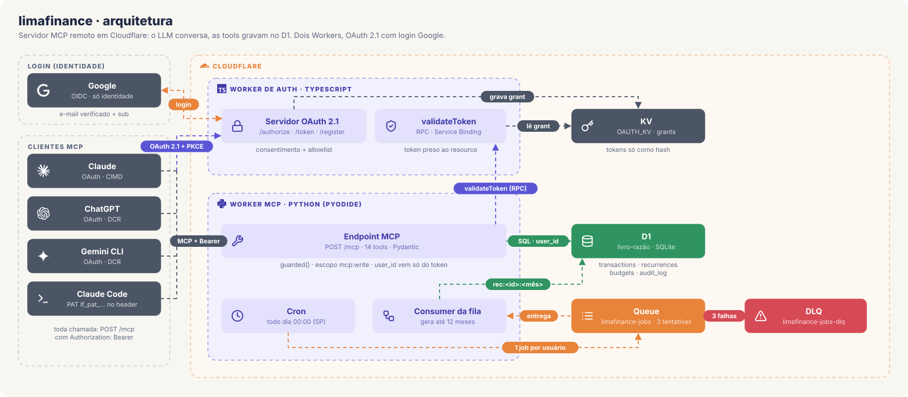
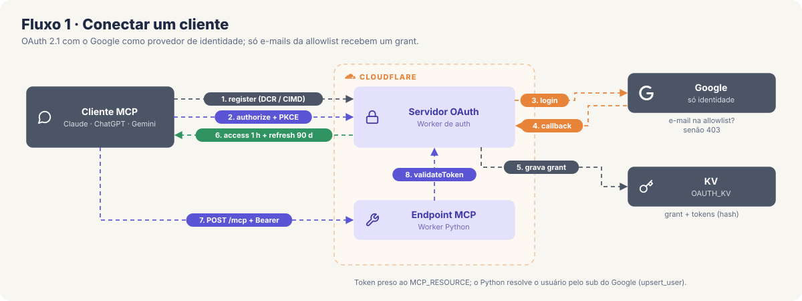
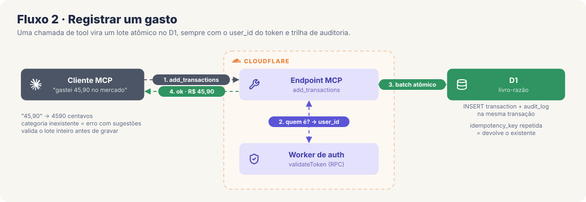
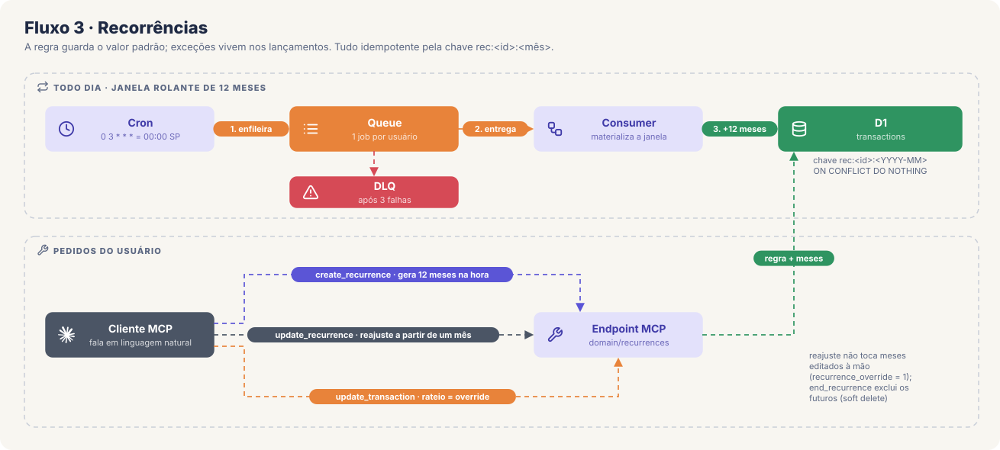

# limafinance

[](https://github.com/eduardopelima/LimaFinance-MCP/actions/workflows/pipeline.yml)


**Controle financeiro pessoal por conversa.** Um servidor [MCP](https://modelcontextprotocol.io) remoto que substitui a
planilha de gastos: você fala com o Claude, o ChatGPT ou o Gemini CLI, e eles registram e consultam seus lançamentos.
Não tem app nem site. Cada pessoa publica a própria instância na própria conta Cloudflare (o plano Free basta), e os
dados nunca passam por este repositório.

> **Você:** gastei 45,90 no mercado ontem e 120 de gasolina hoje<br>
> **Claude:** *(add_transactions)* Registrei 2 saídas: Alimentação › Mercado R$ 45,90 (23/11) e Transporte › Combustível R$ 120,00 (24/11).<br>
> **Você:** o condomínio vai ter rateio de 1.000 em janeiro, fevereiro e março<br>
> **Claude:** *(update_transaction ×3)* Pronto: esses 3 meses ficam em R$ 1.000,00; a partir de abril volta para R$ 510,00.<br>
> **Você:** quanto ainda posso gastar esse mês?<br>
> **Claude:** *(month_summary)* Você gastou R$ 3.212,40 de um teto de R$ 6.000,00. Restam R$ 2.787,60, cerca de R$ 398/dia.



## O que ele faz

- **Lançamentos em linguagem natural**, inclusive em lote ("registra esses 12 da fatura"), atômicos e idempotentes.
- **Consultas**: lista com filtros, resumo do mês por categoria comparado à meta, saldo, teto restante e R$/dia.
- **Competência é diferente de data real**: a fatura de dezembro paga em janeiro conta em dezembro.
- **Recorrências** (aluguel, assinaturas, salário) com os próximos 12 meses já lançados como *previstos*, reajuste a
  partir de um mês e exceções pontuais (rateio, mês pulado) que nunca são sobrescritas.
- **Escrita segura**: categoria inexistente gera erro (nunca é criada sem você pedir), exclusão é reversível e toda
  escrita fica registrada na auditoria.
- **Dinheiro em centavos inteiros**, e "hoje" é calculado no seu fuso (`America/Sao_Paulo`).
- **Importação** do histórico de uma planilha (CSV pt-BR), com dry-run e reexecução segura.

## Como funciona

São dois Workers na sua conta Cloudflare:

- **`<prefixo>`** (Python): o endpoint `/mcp` com as 14 tools, as regras de negócio, o SQL no D1 e os jobs da fila.
  Usa [Cloudflare Python Workers](https://developers.cloudflare.com/workers/languages/python/) e o SDK oficial `mcp` 2.x.
- **`<prefixo>-auth`** (TypeScript): só o servidor OAuth 2.1, com a
  [`workers-oauth-provider`](https://github.com/cloudflare/workers-oauth-provider). Faz login pelo Google, confere a
  allowlist de e-mails e emite tokens. Não lê dados financeiros.

O Worker Python valida cada token chamando o de auth por RPC (Service Binding, sem passar pela internet). Toda query
filtra pelo `user_id` que vem do token, nunca de um parâmetro de tool.

<details>
<summary><b>Fluxo 1 · Conectar um cliente (OAuth)</b></summary>



</details>

<details>
<summary><b>Fluxo 2 · Registrar um gasto</b></summary>



</details>

<details>
<summary><b>Fluxo 3 · Recorrências</b></summary>



</details>

Decisões e trade-offs: [`docs/ARCHITECTURE.md`](docs/ARCHITECTURE.md) · Modelo de segurança: [`SECURITY.md`](SECURITY.md) ·
Convenções para agentes de código: [`CLAUDE.md`](CLAUDE.md). Os diagramas são gerados por
[`docs/architecture/draw.py`](docs/architecture/draw.py) (`python docs/architecture/draw.py`).

## Monte o seu

Tempo estimado: 20 a 30 minutos, quase todo gasto no console do Google.

### Antes de começar

- Uma conta [Cloudflare](https://dash.cloudflare.com/sign-up) (o plano Free serve).
- Uma conta Google (para o login).
- [Node.js](https://nodejs.org) 22+, [uv](https://docs.astral.sh/uv/getting-started/installation/) 0.13.4+ e git.
- No Windows, use o Git Bash para os comandos `.sh`.

### 1. Clone e crie o arquivo de configuração

```sh
git clone https://github.com/eduardopelima/LimaFinance-MCP limafinance && cd limafinance
git config core.hooksPath .githooks          # bloqueia commit de .env, CSV, tokens etc.
cp limafinance.env.example limafinance.env
```

No `limafinance.env`, preencha duas chaves:

| Chave | O que colocar |
|---|---|
| `LF_PREFIX` | Prefixo de todos os recursos. Com `limafinance`, os Workers se chamam `limafinance` e `limafinance-auth`. |
| `CF_WORKERS_SUBDOMAIN` | Seu subdomínio `*.workers.dev`. Está em dash.cloudflare.com → **Workers & Pages** → **Subdomain**, no canto direito. |

O `limafinance.env` fica fora do git e não guarda segredo nenhum.

### 2. Rode o instalador

```sh
uv run --no-project ci/deploy_your_own.py
```

Rode quantas vezes precisar. Ele verifica cada passo antes de agir e pula o que já está pronto: cria o D1, o KV e as
filas, grava os IDs no `limafinance.env`, aplica as migrations, publica os dois Workers e testa o deploy.

Quando precisa de algo que só você pode fazer, ele para com uma linha **`NEEDS:`** e mostra o que fazer. Faça e rode
de novo. São três paradas:

**a) Login na Cloudflare.** Rode `npx wrangler login`. Ele abre o navegador. Se você tiver mais de uma conta,
coloque o `CF_ACCOUNT_ID` no `limafinance.env` (o `npx wrangler whoami` mostra os IDs).

**b) Login com Google.** O instalador imprime a *redirect URI* exata. No
[console do Google Cloud](https://console.cloud.google.com/apis/credentials):

1. Crie um projeto (qualquer nome) ou use um que já exista.
2. Em **OAuth consent screen**, escolha **External**, preencha o nome do app e o seu e-mail e adicione o seu e-mail
   (e o de quem mais for usar) como **test user**.
3. Em **Credentials → Create credentials → OAuth client ID**, escolha **Web application** e, em
   **Authorized redirect URIs**, cole a URI impressa. Ela tem a forma
   `https://<prefixo>-auth.<subdominio>.workers.dev/oauth/google/callback`.
4. Copie o **Client ID** para `GOOGLE_CLIENT_ID` no `limafinance.env` e guarde o **Client secret** para o próximo passo.

Não marque a opção de cliente para agentes de IA: o Google aqui só identifica quem é você. Quem recebe o token é o
seu limafinance.

**c) Segredos.** Você digita os valores num prompt oculto. Eles vão direto para a Cloudflare, sem passar pelo
instalador nem pelo git:

```sh
cd auth
npx wrangler secret put GOOGLE_CLIENT_SECRET --env production
npx wrangler secret put ALLOWED_EMAILS --env production   # ex.: voce@gmail.com,outra@gmail.com
cd ..
```

O `ALLOWED_EMAILS` é a lista de quem pode entrar. Qualquer outro e-mail recebe "Acesso não liberado". Cada pessoa
da lista tem os próprios dados, isolados.

No fim, o instalador imprime o seu endpoint: **`https://<prefixo>.<subdominio>.workers.dev/mcp`**.

### 3. Conecte o seu assistente

| Cliente | Como conectar |
|---|---|
| **Claude** (web, desktop, celular) | Configurações → **Conectores** → Adicionar conector personalizado → cole a URL `/mcp` → entre com o Google. |
| **ChatGPT** | Configurações → **Apps e conectores** → ative o modo desenvolvedor → crie um conector com a URL `/mcp` (OAuth). |
| **Claude Code** | `claude mcp add --transport http limafinance https://<...>/mcp` e depois `/mcp` para fazer o login. Ou use um token fixo (PAT, abaixo). |
| **Gemini CLI** | No `~/.gemini/settings.json`: `{"mcpServers":{"limafinance":{"httpUrl":"https://<...>/mcp","headers":{"Authorization":"Bearer lf_pat_..."}}}}` |

Na tela de consentimento você escolhe se o app pode só ler ou também registrar e editar. Comece a conversa com algo
como *"quais são minhas categorias?"* para o assistente chamar `get_context`.

**Token fixo (PAT)**, para clientes que só aceitam header. O token aparece uma vez só e o banco guarda apenas o hash:

```sh
cd mcp && uv run scripts/create_token.py --email voce@gmail.com --name claude-code --env production [--read-only] [--days 365]
```

### 4. (Opcional) Importe o histórico da planilha

Exporte a planilha como CSV para `mcp/data/` (essa pasta fica fora do git). O formato esperado está em
[`mcp/scripts/exemplo-planilha.csv`](mcp/scripts/exemplo-planilha.csv), com as colunas Mês-Competência, Data,
Categoria, Subcategoria, Descrição, Ocorrência, Valor, Provento, Meta Gasto e Nota.

```sh
cd mcp
uv run scripts/import_planilha.py --file data/planilha.csv --email voce@gmail.com      # dry-run: confira import-out/report.txt
uv run scripts/import_planilha.py --file data/planilha.csv --email voce@gmail.com --apply --env production
```

Use o mesmo e-mail do login Google. Opções úteis:

| Opção | Para quê |
|---|---|
| `--income-categories "Salário,Rendimentos"` | categorias que são entrada (o resto vira saída) |
| `--skip-uncategorized` / `--default-category X` | o que fazer com linhas sem categoria (o padrão é dar erro) |
| `--until 2026-11 --recurrences-from-deferred` | não importa meses futuros; as linhas "Mensal" desses meses viram recorrências |

Rodar de novo não duplica nada.

### 5. Atualize quando sair versão nova

```sh
git pull
bash ci/deploy.sh production      # migrations → auth → mcp
cd mcp && uv run scripts/check_deploy.py --env production
```

As migrations só adicionam colunas e tabelas, então o código antigo continua funcionando durante o deploy.

<details>
<summary><b>Deploy automático pelo GitHub Actions (opcional)</b></summary>

O [`pipeline.yml`](.github/workflows/pipeline.yml) roda testes, typecheck, E2E com os dois Workers e dry-run do
bundle em todo PR. Com o deploy ligado, cada merge na `main` publica em **staging** e, se a verificação passar, em
**production**. Se a verificação pós-deploy falhar, o código volta sozinho para a versão anterior.

Para ligar no seu fork:

1. **Secrets do repositório**: `CLOUDFLARE_API_TOKEN` (template "Edit Cloudflare Workers" + D1:Edit + Queues:Edit) e
   `CLOUDFLARE_ACCOUNT_ID`.
2. **Environments** `staging` e `production`, com as chaves do `limafinance.env` como *Variables* (`LF_PREFIX`,
   `CF_WORKERS_SUBDOMAIN`, `GOOGLE_CLIENT_ID`, `D1_ID_*`, `KV_ID_*`). Opcional: o secret `SMOKE_TOKEN`, um PAT
   só-leitura daquele ambiente.
3. Crie o ambiente de staging uma vez: `uv run --no-project ci/deploy_your_own.py --env staging`.
4. **Variável do repositório** `DEPLOY_ENABLED=true`. Sem ela, o fork roda só o CI.

</details>

## No dia a dia

Fale normalmente. Alguns pedidos que funcionam bem:

| Você diz | O que acontece |
|---|---|
| "gastei 32 de uber ontem" | `add_transactions` com a data de ontem no seu fuso |
| "a fatura do cartão de dezembro deu 2.340, paguei dia 10/01" | lançamento com competência dezembro e data 10/01 |
| "aluguel de 1.800 todo dia 5, a partir de janeiro" | `create_recurrence`; os 12 meses aparecem como previstos |
| "o aluguel subiu para 1.950 desde março" | `update_recurrence` a partir de março, sem mexer nos meses que você editou à mão |
| "em julho não vou pagar a academia" | exclui só o lançamento de julho; a regra continua |
| "cancelei a Netflix em agosto" | `end_recurrence`: os meses seguintes são excluídos (dá para restaurar) |
| "meta de 6.000 para dezembro" | `set_budget` com teto global |
| "como fechou outubro?" | `month_summary`: entradas, saídas, categorias e o que está previsto |

<details>
<summary><b>As 14 tools</b></summary>

| Tool | Tipo | |
|---|---|---|
| `get_context` | leitura | hoje (no fuso do usuário), mês atual e árvore de categorias |
| `list_categories` | leitura | |
| `list_transactions` | leitura | competência, datas, tipo, categoria (inclui subcategorias), texto, excluídos, paginação e totais; marca `previsto` |
| `month_summary` | leitura | entradas, saídas, saldo, categoria vs. meta, teto global, R$/dia, realizado vs. previsto |
| `list_recurrences` | leitura | regras ativas e até que mês já foram geradas |
| `add_transactions` | escrita | lote de 1 a 100, atômico, com `idempotency_key` por item |
| `update_transaction` | escrita | patch parcial; num lançamento de recorrência, vira exceção pontual |
| `delete_transactions` / `restore_transactions` | escrita | exclusão reversível |
| `create_category` | escrita | único caminho para criar categoria |
| `set_budget` | escrita | meta mensal por categoria ou teto global |
| `create_recurrence` | escrita | regra mensal; gera na hora até 12 meses à frente (ou até o fim); backfill opcional |
| `update_recurrence` | escrita | reajuste permanente a partir de um mês (pode ser passado); preserva meses editados à mão |
| `end_recurrence` | escrita | encerra e exclui os lançamentos gerados depois do último mês |

</details>

## Problemas comuns

| Sintoma | Causa provável |
|---|---|
| "Acesso não liberado" no login | o e-mail não está no `ALLOWED_EMAILS` (`npx wrangler secret put ALLOWED_EMAILS --env production` no `auth/`) |
| Google diz `redirect_uri_mismatch` | a redirect URI do OAuth client não é idêntica à que o instalador imprimiu |
| Google diz "app não verificado" ou bloqueia | o e-mail não foi adicionado como *test user* na OAuth consent screen |
| O assistente não vê uma tool nova | desconecte e reconecte o conector (os clientes guardam a lista de tools) |
| Claude ou ChatGPT não conectam, mas o `curl` funciona | Bot Fight Mode ou WAF da Cloudflare bloqueando os clientes; libere o `/mcp` |
| `wrangler` reclama de várias contas | defina `CF_ACCOUNT_ID` no `limafinance.env` |
| Script `.sh` quebra no Linux/CI | o arquivo foi salvo com CRLF; o repositório usa LF (`.gitattributes`) |

## Desenvolvimento

```sh
cd auth && npm install && cp .dev.vars.example .dev.vars && cd ..   # ALLOWED_EMAILS do login dev
cd mcp && uv sync && cp .dev.vars.example .dev.vars && cd ..
uv run --no-project ci/render_config.py                              # gera auth/ e mcp/wrangler.jsonc
(cd mcp && npx wrangler d1 migrations apply DB --local --persist-to ../.wrangler/state)

# dois terminais
cd auth && npx wrangler dev --port 8788 --persist-to ../.wrangler/state
cd mcp  && uv run pywrangler dev --port 8787 --persist-to ../.wrangler/state

cd mcp && uv run pytest        # unitários + domínio contra SQLite com as migrations reais
bash ci/e2e.sh                 # o mesmo E2E do CI (pare os wrangler dev antes: usa as portas 8787/8788)
```

Localmente, a página de consentimento oferece um **login dev** (sem Google), que só funciona em `localhost`. Para
inspecionar as tools, use o [MCP Inspector](https://github.com/modelcontextprotocol/inspector):

```sh
npx @modelcontextprotocol/inspector --cli http://localhost:8787/mcp --transport http \
  --header "Authorization: Bearer lf_pat_..." --method tools/list
```

Regras do código (dinheiro em centavos, "hoje" no fuso do usuário, `user_id` só do token, migrations só para frente)
estão no [`CLAUDE.md`](CLAUDE.md).

## Licença

[MIT](LICENSE)
